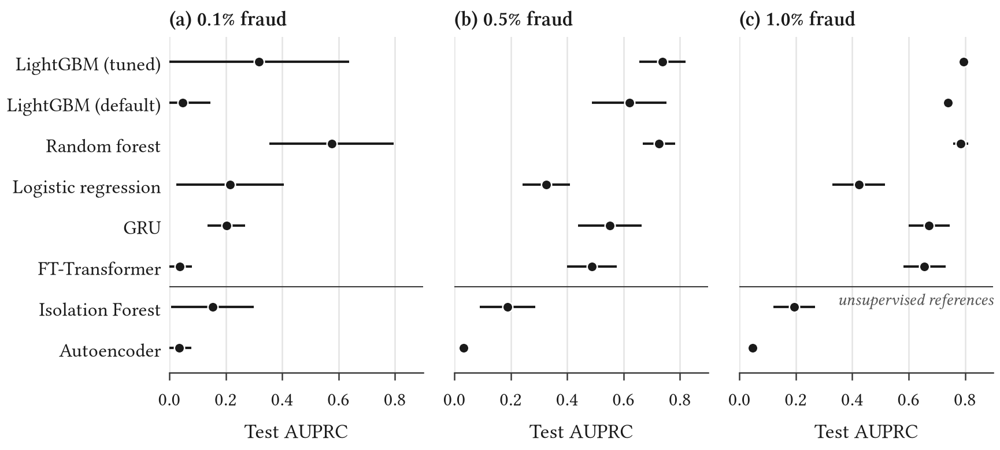

# fraud-synth-bench

**Reproducible fraud-analytics research on synthetic data.** This repo contains a seeded transaction generator with pluggable fraud scenarios, and a pre-registered comparison of classic and modern fraud models. The comparison runs under extreme class imbalance, concept drift, ring fraud, label delay and limited investigator capacity. Every number in the paper is rebuilt by one command.

> **Limitations first: this is synthetic data.** No real transactions are used anywhere. The generator encodes *published patterns* of fraud, not measurements of any real payment system. The results are evidence about how models behave under controlled mechanisms, not predictions of production performance. See [Limitations](#limitations).

## 📄 Paper

### [Old and New Fraud Detectors Under Controlled Imbalance, Drift, Ring Fraud and Label Delay: A Reproducible Study on Synthetic Data](paper/paper.pdf)

**[Read the PDF](paper/paper.pdf)** · [Markdown version](paper/paper.md) · [Executive summary](docs/EXEC_SUMMARY.md) · [Pre-registered research questions](docs/RESEARCH_QUESTIONS.md)

Key findings (all on synthetic data, 5 paired seeds per comparison):

- **Classic beats modern here.** A tuned LightGBM was never beaten by FT-Transformer at 0.1–1% fraud, and it won clearly at 0.5% and 1%. TabPFN couldn't be evaluated (license token).
- **Graph features, not graph networks.** LightGBM with hand-crafted graph features was never beaten by a time-respecting GraphSAGE, and those features helped once fraud rings were common.
- **Operations matter more than the model.** A mid-stream switch in fraud tactics wiped out most of every model's ranking quality. Refitting weekly on all labels recovered it, while retraining with a validation holdout did not. Realistic label delay cost the best model about half its AUPRC.
- **Measure value, not just AUPRC.** With a fixed analyst capacity, ranking alerts by expected loss recovered more money, and AUPRC ranked models only approximately like recovered value.

<p align="center"></p>

Every number in the paper is filled in from [`results/summary.json`](results/summary.json) by `make reproduce`.

## Quickstart

```bash
brew install libomp pandoc        # macOS: LightGBM's OpenMP runtime; pandoc builds the paper
make setup                        # uv sync --locked (Python 3.12, pinned dependencies)
make quick                        # smoke run, under 5 minutes
make reproduce                    # all experiments → tables, figures, results/summary.json, paper/paper.pdf
```

`make reproduce` took about 50 minutes on a MacBook Air M4 (16 GB) from a fresh clone, within a 90-minute budget, and needs no GPU. Per-stage wall times are in [`results/timing.json`](results/timing.json), and the hardware profile is in [`results/hardware.json`](results/hardware.json).

## Headline results

<!-- headline:start -->
| Model | AUPRC @ 0.1% fraud | AUPRC @ 0.5% fraud | AUPRC @ 1% fraud |
|---|---|---|---|
| LightGBM (tuned) | 0.318 ± 0.258 | 0.738 ± 0.066 | 0.795 ± 0.014 |
| LightGBM (default) | 0.048 ± 0.079 | 0.620 ± 0.106 | 0.739 ± 0.015 |
| Random forest | 0.576 ± 0.177 | 0.726 ± 0.046 | 0.784 ± 0.022 |
| Logistic regression | 0.215 ± 0.153 | 0.326 ± 0.068 | 0.423 ± 0.075 |
| GRU | 0.202 ± 0.054 | 0.552 ± 0.091 | 0.673 ± 0.058 |
| FT-Transformer | 0.036 ± 0.036 | 0.488 ± 0.071 | 0.656 ± 0.060 |
| Isolation Forest | 0.153 ± 0.117 | 0.189 ± 0.079 | 0.195 ± 0.060 |
| Autoencoder | 0.035 ± 0.035 | 0.032 ± 0.011 | 0.046 ± 0.014 |

Test AUPRC, mean ± std over 5 seeds, `small` preset (about 200k transactions). Generated by `make reports` from `results/summary.json`.

Pre-registered hypotheses: H1a: not refuted, H1b: refuted, H2a: not refuted, H2b: not refuted, H3a: not refuted, H3b: not refuted, H4a: not refuted, H4b: not refuted, H5a: not refuted, H5b: refuted.
<!-- headline:end -->

The full results, with statistical tests, are in the paper ([`paper/paper.pdf`](paper/paper.pdf), source [`paper/paper.md`](paper/paper.md)). A one-page business summary is in [`docs/EXEC_SUMMARY.md`](docs/EXEC_SUMMARY.md).

## Research questions

Hypotheses and decision thresholds were fixed **before** any data was generated ([`docs/RESEARCH_QUESTIONS.md`](docs/RESEARCH_QUESTIONS.md)). Each comparison uses 5 paired seeds, t-intervals, Holm correction, and an equivalence margin of 0.02 AUPRC.

| RQ | Question |
|---|---|
| RQ1 | At 0.1–1% fraud, do modern tabular models (FT-Transformer, TabPFN) beat a *tuned* GBDT on AUPRC? |
| RQ2 | When fraudsters switch tactics mid-stream, which model family degrades least, and how much does weekly retraining recover? |
| RQ3 | Does ring fraud (mules, shared devices, colluding merchants) give GraphSAGE an edge over LightGBM with hand-crafted graph features? |
| RQ4 | How much does a realistic 7–30-day label delay hurt, and do unsupervised anomaly scores mitigate it? |
| RQ5 | With a fixed investigator capacity (20 alerts a day), which model recovers the most loss per investigator-hour, and does AUPRC rank models the same way? |

## Repository layout

```
src/fraudlab/
  synth/        generator: world model, 8 fraud scenario injectors, drift, labels
  features/     past-only tabular and graph features (leakage-tested)
  models/       common fit / predict_proba / explain interface, one module per family
  eval/         temporal splits, metrics, cost model, paired statistics
  runner.py     YAML experiment runner → results/runs/*.jsonl
  cli.py        fraudlab generate | train | probe
experiments/    configs/*.yaml + one report script per RQ
results/        summary.json, tables/, figures/ (committed for the headline run)
paper/          paper.tmpl.md → paper.md → paper.pdf
docs/           literature review, research questions, decisions, data card, exec summary
tests/          pytest (generator, features, eval, runner)
```

## Extending

**Add a fraud scenario.** Subclass `Scenario` in `src/fraudlab/synth/scenarios/`, implement `event()` (the transactions of one fraud event), cite the pattern you imitate in the docstring, decorate it with `@register`, and add its name to `ALL_SCENARIOS` in `synth/config.py`. Then add a signature test to `tests/test_synth.py`. The generator handles budgets, drift schedules, labels and delay. See `synth/scenarios/base.py`.

**Add a model.** Subclass `FraudModel` in `src/fraudlab/models/`. Implement `fit(data, train_idx, valid_idx)` and `predict_proba(data, idx)`; `explain` has a permutation-importance default. Register it in `MODELS` in `models/__init__.py`, then list it in an experiment YAML. Models receive row indices into a time-ordered `ModelData`, so sequence and graph models can look back at past rows.

**Add an experiment.** Write a YAML under `experiments/configs/` (dataset × conditions × models × protocol × seeds), run `uv run fraudlab train --config …`, and add a report script that writes to `results/summary/`.

## Optional components

- **TabPFN** needs the `tabpfn` extra and a one-time license acceptance for its weights (`export TABPFN_TOKEN=…`, see [priorlabs.ai](https://ux.priorlabs.ai)). Without them it's skipped, and the skip is recorded in `results/skipped.json`. `make reproduce` never requires it. To include it: `uv sync --extra tabpfn && TABPFN_TOKEN=… make reproduce`.
- No CUDA is required. Neural models use Apple MPS where it's faster, and CPU otherwise ([DECISIONS](docs/DECISIONS.md) D022).

## Limitations

1. **This is synthetic data.** Distributions are stylised, not calibrated to any institution ([data card](docs/data/DATA_CARD.md)). Absolute AUPRC values aren't comparable with published numbers on real data. Only the *relative* findings under controlled conditions are meaningful.
2. Each fraud scenario has a clean mechanism. Real fraudsters mix tactics and adapt to the deployed model, and there's no feedback loop here.
3. The experiments use about 200k transactions per dataset and 5 seeds. Ring scenarios contribute only a handful of events per dataset, so some comparisons are inconclusive by design rather than by accident.
4. TabPFN results depend on an optional, licensed component. See `results/skipped.json` for whether it ran.
5. Model budgets are deliberately modest so the suite fits a fanless laptop in about 90 minutes: Optuna uses ≤30 trials, and the neural models use fixed architectures (FT-Transformer d = 64, 3 blocks) trained for ≤20 undersampled epochs. Larger budgets could change neural-model results.

## Citation

See [`CITATION.cff`](CITATION.cff).

## License

Apache-2.0. The bundled IEEE citation style (`paper/ieee.csl`) is CC BY-SA 3.0, from the Citation Style Language project.
